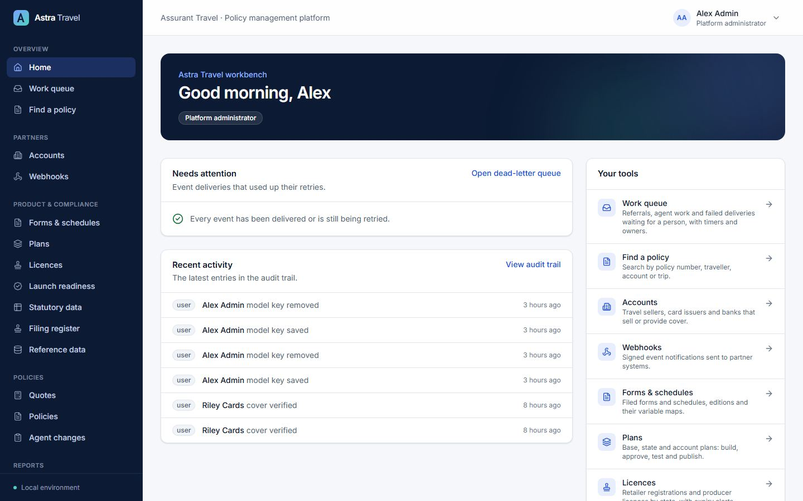
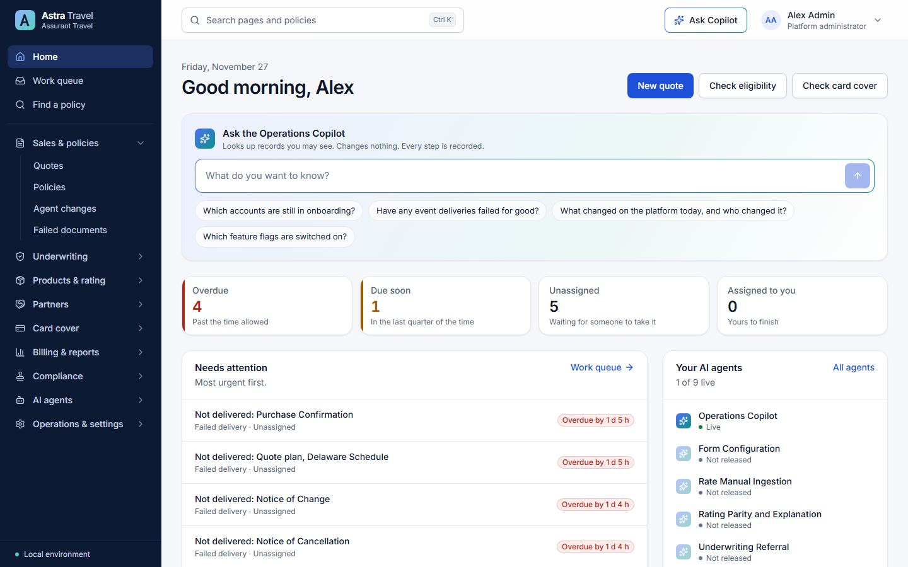
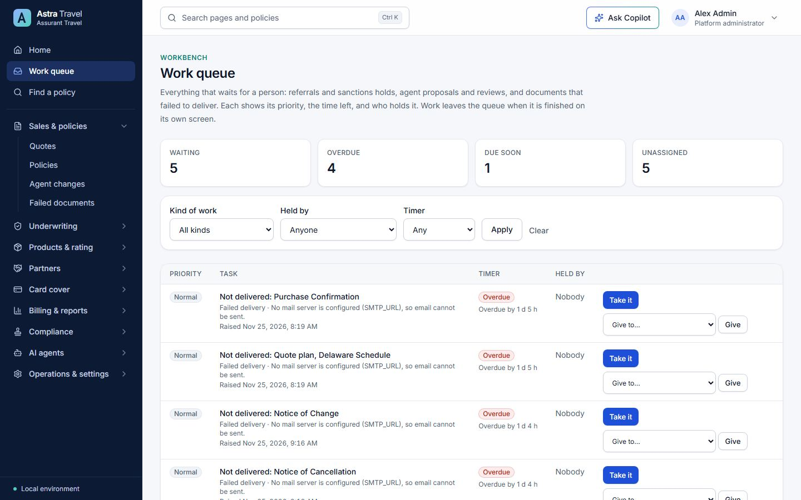
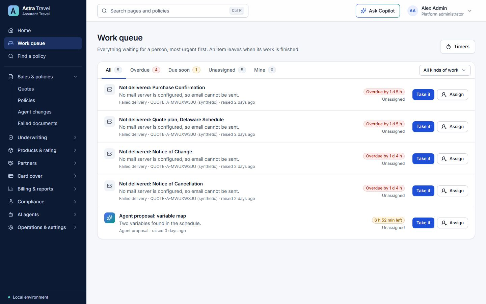
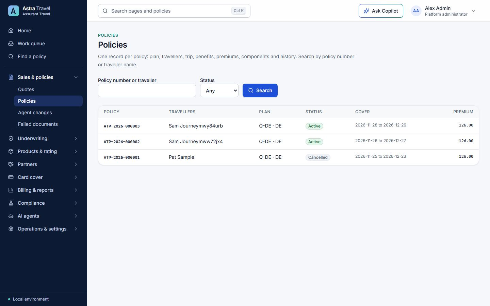
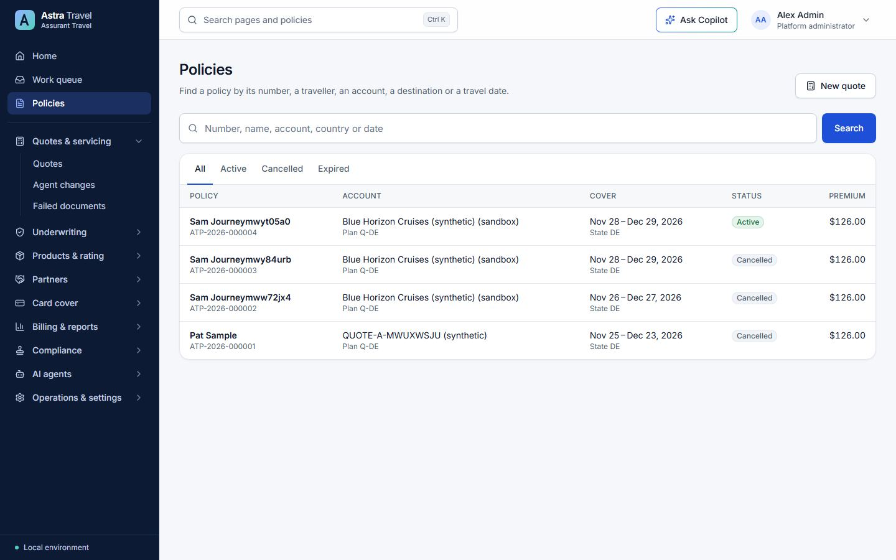
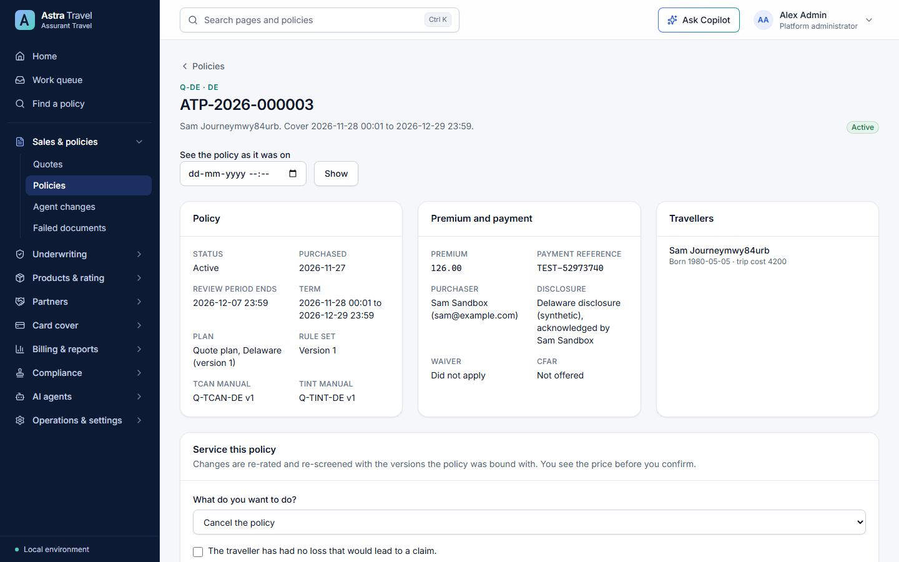
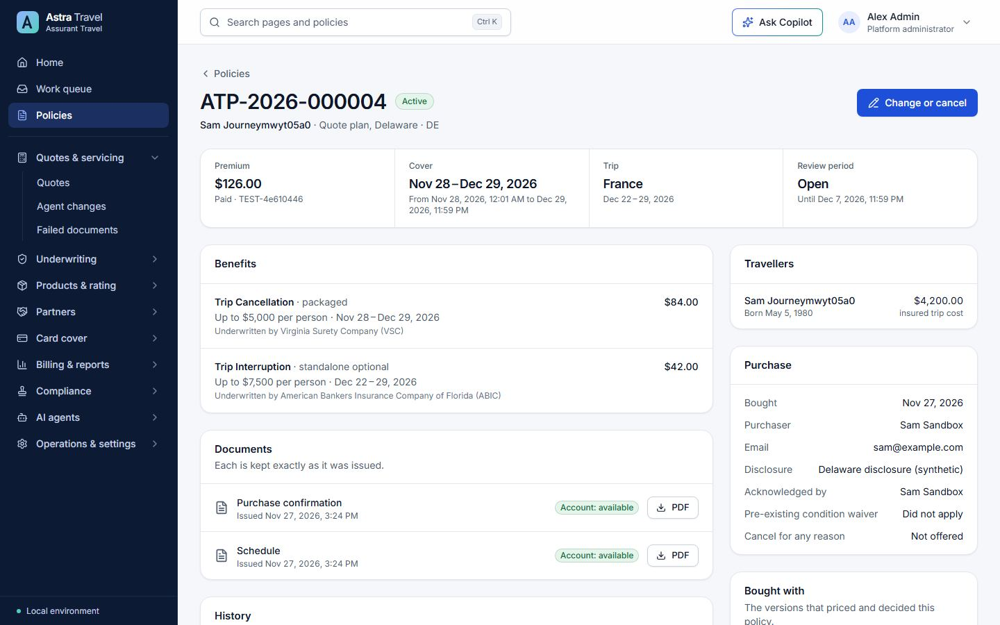

# Astra Travel UX: page-by-page review and fixes

Started 2026-11-27, on the local app with synthetic data. Each page is reviewed, fixed and checked
before the next one starts. Screenshots are in [screenshots](screenshots/).

## Design direction

- Calm, dense, plain-language screens for operations staff.
- Agents are visible and honest: the Copilot is one keystroke away on every page, agent work has one
  recognisable mark, and every number, status and run shown comes from the platform. Nothing is
  simulated.
- Phone, tablet, desktop, light and dark all work.

## 1. Shell (navigation, top bar) and Home: done

| Before | After |
| --- | --- |
|  |  |

### Found and fixed

| Severity | What a user experienced | Fix |
| --- | --- | --- |
| Blocker | Home said nothing needed attention while four items in the work queue were overdue. | Home shows the work queue: counts, and the most urgent items with time left. |
| Blocker | About 40 links in a flat sidebar; most were below the fold. | Three fixed links and nine groups by job. A person's own groups start open. |
| Blocker | The product did not look or behave like an agentic platform; the Copilot was a page deep in the menu. | Ask box on Home; "Ask Copilot" (Ctrl J) opens it beside any page and keeps the conversation; agent roster, proposals waiting and latest runs on Home. |
| Major | Home repeated the whole menu as a "Your tools" list, over 3,700 px tall. | Removed. Role-based action buttons, plus search. |
| Major | The top bar held only a tagline. | Search for pages and policies (Ctrl K), which can also ask the Copilot. |
| Major | Developer wording: "dead-letter queue", "model key removed", "user" labels. | Plain sentences. |
| Major | The logo mark vanished on phones. | Fixed. |
| Minor | The greeting used US Eastern time for everyone. | Uses the viewer's clock. |

Phone: [before](screenshots/01-home-phone-before.jpg), [after](screenshots/01-home-phone-after.jpg).
Also: [Copilot beside a page](screenshots/01-copilot-panel.jpg), [search](screenshots/01-search.jpg).

### Checked

- Type check and lint of the workbench.
- Automated accessibility checks (axe, WCAG 2.2 AA) with no violations on Home (light, dark, 320,
  390, 820 and 1280 px, three roles), search, the Copilot panel and the phone menu.
- Keyboard: Ctrl K, Enter, Ctrl J. No sideways scrolling on Home.
- All 43 pages in the end-to-end list load.
- The navigation test (updated for groups) passes on desktop and phone. The sign-out test failed once
  on phone with Keycloak's "Invalid username or password", then passed twice on rerun.
- One run over all pages logged a React server/client mismatch warning. Two reruns did not.

### Not checked

- A real Copilot answer. The question request was blocked on purpose so that no model call was made.
- A production build, and the rest of the end-to-end tests.
- Screen reader testing.

### Left for later

- An agent shows "Live" from its approval even when no model key is saved; the question then fails
  with "The AI service could not be reached". Home should say a key is missing.
- Home on an empty environment (such as Azure) needs a short set-up checklist.

## 2. Work queue: done

| Before | After |
| --- | --- |
|  |  |

### Found and fixed

| Severity | What a user experienced | Fix |
| --- | --- | --- |
| Blocker | On a phone, the owner and every action were off the screen, and the page scrolled sideways. | Rows stack, with the actions under each item. The cause (hidden text in wide tables) is fixed for every table in the app. |
| Major | Every row repeated a button, a drop-down and a second button. | One "Take it" button and an "Assign" menu showing how much each person holds. |
| Major | A server setting name, `SMTP_URL`, appeared in four rows. | Setting names are removed from what users read. Event names are written as words. |
| Major | Four count boxes and a three-field filter form came before the work, and the form needed "Apply". | Views with counts (All, Overdue, Due soon, Unassigned, Mine) and one kind menu, applied at once. |
| Major | Timer settings took half the page, with wording about "the specification". | Behind a "Timers" button, in plain words. |
| Minor | Rows did not say which account the work belonged to, or what kind it was at a glance. | Account name, an icon per kind, and the agent mark on agent work. |

Items from an undelivered event also offer "Ask Copilot", which asks it why the delivery failed. It is
offered only there, because those are records the Copilot can read.

Phone: [before](screenshots/02-work-phone-before.jpg), [after](screenshots/02-work-phone-after.jpg).
Also: [assigning work](screenshots/02-work-assign.jpg).

### Checked

- Type check and lint. Both work queue end-to-end tests pass on desktop (the first was updated for
  the new controls; the search test now names its button exactly).
- Axe with no violations on the queue (light, dark, 320, 390, 820 and 1280 px), the Assign and kind
  menus, and the Timers window.
- An underwriter took an item, saw it under Mine, and handed it back.
- A supervisor saved a timer; the page confirms it.
- No sideways scrolling on a phone for Accounts, Audit trail, Events and Forms.

### Not checked

- The "Ask Copilot" row button: the local queue holds no undelivered event.

### Left for later

- Taking or assigning several items at once (four of the five local items share one cause).
- The worker still writes `SMTP_URL` into the message; other screens that show it need the same
  cleaning, or the message should change at its source.

## 3. Policies and the policy record: done

| Before | After |
| --- | --- |
|  |  |
|  |  |

### Found and fixed

| Severity | What a user experienced | Fix |
| --- | --- | --- |
| Blocker | Confirming a correction could fail with "The Idempotency-Key was already used with a different request", once a similar change had been confirmed anywhere. This predates the redesign. | Each preview now has its own key. |
| Major | Two search pages ("Find a policy" and "Policies") with different boxes and different results. | One Policies page: one box (number, traveller, account, country or date), status views, newest first until you search. The old address leads there. |
| Major | The change form sat in the middle of the record, above documents and benefits, always open. | A "Change or cancel" button opens it over the record; the price and Confirm scroll into view. |
| Major | The record led with internal versions; premium, cover and trip had to be hunted for. | Premium, cover, trip and review period across the top; benefits, documents, billing and history below; versions last. |
| Major | On a phone, benefits and documents ran off the screen. | Lists that stack, with no sideways scrolling. |
| Minor | Raw values: `126.00`, `2026-11-28 00:01`, `FR`, "TCAN manual", "CFAR", search time in milliseconds. | Money, dates and countries written out; plain labels. |

Phone record: [before](screenshots/04-record-phone-before.jpg), [after](screenshots/04-record-phone-after.jpg).
Also: [previewing a cancellation](screenshots/04-record-service.jpg).

### Checked

- Type check and lint.
- End-to-end on desktop: the correction and cancellation journey (passes after the key fix), both work
  queue tests and the purchase journey. The navigation test passes on desktop and phone.
- Axe with no violations on the list, search, record, change window and cancelled record, in light and
  dark and at 320, 390, 820 and 1280 px. Search, redirect, "look back", and opening the schedule PDF.

### Not checked

- `policies.spec.ts` stops on this database before it reaches the policy screens: the quote it uses
  already has the option it ticks. Its policy steps were repeated in a separate check, and passed.

### Found outside the workbench: fixed

`GET /v1/plan-versions/:id` returned 500 for a plan version stored before the `servicing` field
existed. The API now reads such versions with defaults (commit `d8bfdca`, made in another session).
After restarting the API, `documents.spec.ts` passes on desktop.

## 4. Every page: shared fixes

| Severity | What a user experienced | Fix |
| --- | --- | --- |
| Blocker | On phones, wide tables ran off the screen. | Tables stack into labelled records on phones; grids with more than seven columns still scroll. |
| Major | Forms showed raw checks such as "Too small: expected string to have >=1 characters" and "Invalid ISO date". | Plain words, and field names as they appear on the form. |
| Major | Long, technical descriptions under page titles ("dead-lettered", "specification", "prototype rater"). | One plain sentence per page; engineering words replaced across screens. |
| Minor | A blank screen while pages loaded; a bare "404" for a missing record. | A loading outline, and a "We couldn’t find that" page with ways on. |

## 5. Quotes and the traveller’s purchase pages

| Before it | Now |
| --- | --- |
| Extra travellers typed as comma-separated lines. | Add and remove travellers; the state fills from the plan; countries by name; rare fields under "More options". |
| The quote led with a form to issue the policy and raw rating codes. | Price and decision first; "Issue policy" opens when wanted; worksheets behind a disclosure. |
| Travellers typed two-letter country codes on an unstyled form. | A three-step journey in the partner’s colours, a country list, clear price and payment steps. |
| The widget preview logged a rendering error. | The widget script loads after the page. |

Screens: [quote](screenshots/05-quote-after.jpg), [traveller price](screenshots/05-journey-price-after.jpg),
[traveller on a phone](screenshots/05-journey-phone-after.jpg).

## 6. Accounts, underwriting and agents

- Accounts: status views; an account has Overview, Onboarding and Sales channels sections; onboarding
  progress on the overview; the checklist stays in view while you set things up.
- Underwriting: referrals waiting come first; a referral leads with the agent’s summary and keeps the
  decision in view; the eligibility check is grouped into traveller, trip and sale.
- Agents: the registry shows what is working, what waits for people and the month’s spend; an agent that
  is not released shows the four steps left; tools are named in words.

## 7. Products, card cover, billing, compliance and operations

Wording and layout fixes: audit entries and events in words, "My access" grouped by area, money formatted
in reports, a template for booking files, and no server setting names in delivery failures. These pages
gained the shared fixes above but were **not redesigned one by one**: plan builder, rate manuals, rating
calculator, forms and variable maps, reference data, card programmes and feeds, billing and compliance.

## Verification of sections 4 to 7, 2026-11-28

- Type check, ESLint and Prettier pass.
- Full end-to-end suite: 24 passed, 3 failed, 29 skipped (live-model tests, journeys that run on
  desktop only, and two agent configuration journeys). It includes the accessibility sweep of every
  listed screen on desktop and phone, which passed.
- The three failures were fixed or explained, and pass on rerun:
  - faded "Reference" text in form errors failed contrast (fixed; the same pass fixed three buttons
    that used a colour that does not exist);
  - the quote test ticked an option that was already ticked (the test now toggles it);
  - the card programme journey ran while the worker process had exited.
- 24 record pages pass axe, with no sideways scrolling or console errors, in light, dark and on a
  phone width.
- Not checked: the referral, rule set and billing record pages (no such record was found locally),
  a real Copilot answer, a production build and screen readers.

### Found outside the workbench: not fixed

The worker process exited on an unhandled database error (`25P04`, transaction timeout). Nothing
restarted it, so feeds and other background work stopped until it was started again.

## Backlog

### B-01 Responsive on phones, proven on Android and iOS

Asked for by the user on 2026-11-28: make sure the app is responsive and opens on Android and iOS
phones, and test it with the simulators.

Done when:

- every workbench screen and the traveller journey open, with no sideways scrolling, in Chrome on an
  Android emulator and in Safari on an iOS simulator;
- sign-in, navigation, search, the Copilot panel, forms (including date and file fields) and PDF
  links work by touch on both;
- results and screenshots are recorded here.

State: layouts are checked with Chromium device emulation only. No Android SDK or emulator is
installed on the build machine, and the iOS simulator needs a Mac with Xcode.

## Left to do

- The sign-in page’s look is Keycloak’s theme (`infra/`), outside the workbench.
- Deeper redesign of the pages listed in section 7, starting with the plan builder and rating calculator.
- Taking or assigning several queue items at once.
- Say on Home when no model key is saved, since an agent still shows "Live".
- A set-up checklist for an empty environment.
